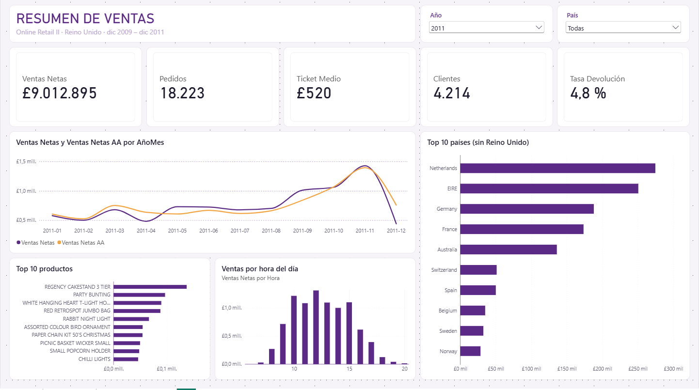
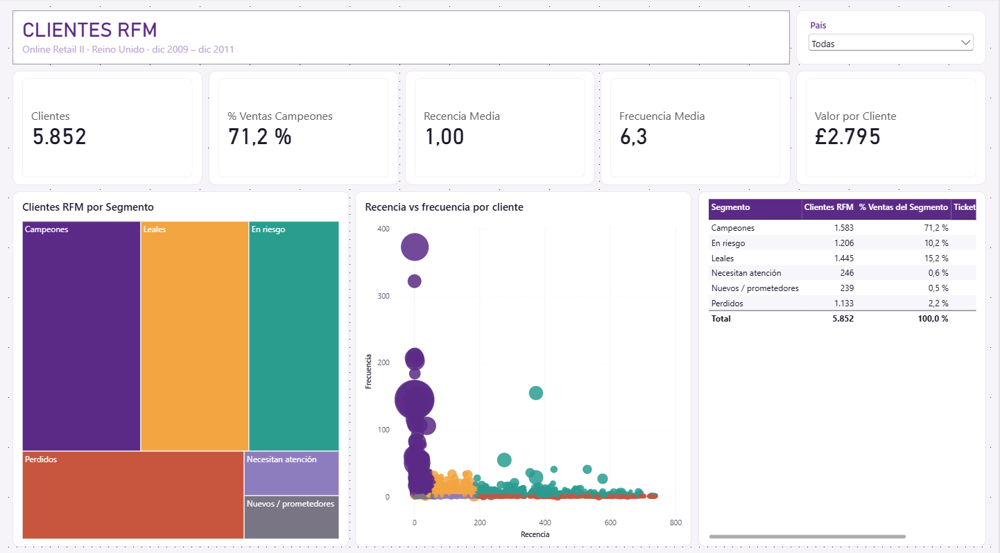
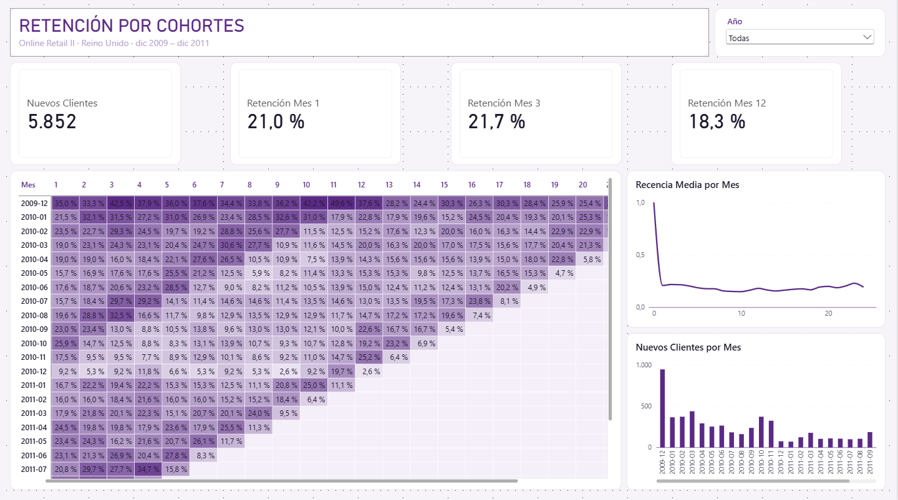

# E-commerce — Ventas, segmentación RFM y retención por cohortes

Dashboard de Power BI sobre dos años de transacciones de una tienda online británica de artículos de regalo (dic 2009 – dic 2011): evolución de ventas, segmentación de clientes por comportamiento de compra (RFM) y retención mensual por cohortes de alta. Construido sobre un esquema en estrella a partir de algo más de un millón de líneas de factura.

> **Nota**: los datos son reales y anonimizados (UCI Machine Learning Repository). El dataset no incluye costes, por lo que el informe trabaja con ingresos y no con márgenes. El valor por cliente es el ingreso histórico acumulado, no un LTV predictivo. Diciembre de 2011 solo contiene datos hasta el día 9 y se excluye de las comparativas mensuales.

## El dashboard

Informe de tres páginas, filtrable por año y país.

**Resumen de ventas** — Ventas netas, pedidos, ticket medio, clientes y tasa de devolución. Evolución mensual frente al año anterior, top 10 de países (sin Reino Unido, que concentra la mayor parte del volumen), top 10 de productos y distribución de ventas por hora del día.


**Clientes RFM** — Segmentación de 5.852 clientes en seis grupos (Campeones, Leales, Nuevos / prometedores, Necesitan atención, En riesgo y Perdidos) a partir de puntuaciones de recencia, frecuencia y valor monetario. Peso de cada segmento en clientes y en ventas, y dispersión recencia vs. frecuencia por cliente.


**Retención por cohortes** — Matriz de calor con el porcentaje de clientes de cada cohorte de alta que vuelve a comprar en los meses siguientes, curva de retención media y nuevos clientes por mes.


## Modelo de datos

Una tabla de hechos de líneas de venta (`fVentas`) con dimensiones de cliente, producto y calendario, más una tabla desconectada (`Desfase`) que define las columnas de meses de la matriz de cohortes.

Aspectos técnicos destacados:

- **Limpieza en Power Query**: eliminación de duplicados exactos, líneas con precio cero y códigos que no son producto (portes, comisiones, ajustes). Normalización de `StockCode` a mayúsculas para evitar claves duplicadas, ya que el motor no distingue mayúsculas en las relaciones. Las devoluciones (facturas con prefijo `C`) se marcan en lugar de borrarse.
- **RFM en DAX**: recencia, frecuencia y valor monetario como columnas calculadas en la dimensión de cliente. Puntuaciones del 1 al 5 por quintiles con `RANKX`, aplicando `ALL` sobre columnas concretas para evitar dependencias circulares.
- **Cohortes con tabla desconectada**: una medida que, para cada cliente de la cohorte, comprueba si compró *k* meses después de su alta. La retención media promedia solo las cohortes con dato disponible para cada mes, para no penalizar a las cohortes recientes.
- **Inteligencia de tiempo**: comparación interanual con `SAMEPERIODLASTYEAR` sobre una tabla de calendario propia.
- **Formato condicional** con rango fijo y una medida auxiliar que excluye el mes 0, para que el 100 % inicial no distorsione la escala de color.

## Stack

Power BI · DAX · Power Query · modelado en estrella

## Fuente de datos

Chen, D. (2012). *Online Retail II* [Dataset]. UCI Machine Learning Repository. https://doi.org/10.24432/C5CG6D — licencia [CC BY 4.0](https://creativecommons.org/licenses/by/4.0/).

## Estructura del repositorio

```
.
├── README.md
├── dashboard.pbix
└── images/
    ├── resumen_ventas.png
    ├── clientes_rfm.png
    └── cohortes.png
```
